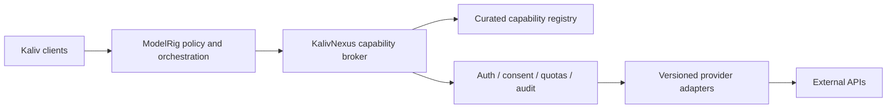

# KalivNexus

KalivNexus is the proposed integration and capability-discovery layer for the Kaliv ecosystem. **Status: offline prototype with automated contract tests; integration design remains a proposal.** No runtime, API compatibility, deployed service or production readiness is asserted by this document.

## Purpose

Provide a governed way to discover, describe and invoke external capabilities without coupling ModelRig or Kaliv clients to each provider's API. The [API-mega-list](https://github.com/cporter202/API-mega-list) is an inspiration and candidate catalog, **not** an automatically trusted or enabled integration registry.

## Ecosystem boundaries

- [ModelRig](https://github.com/Ternedal/ModelRig): orchestration, cognitive state, authenticated client facade, tool authorization and user confirmations.
- [Kaliv](https://github.com/Ternedal/Kaliv): public website/product presentation; application clients use ModelRig's approved interfaces.
- [VoiceRig](https://github.com/Ternedal/VoiceRig): voice packages and TTS.
- [VisionRig](https://github.com/Ternedal/VisionRig): sensor ingestion and structured visual observations.
- [BodyRig](https://github.com/Ternedal/BodyRig): body identity and motor state.
- [LanguageRig](https://github.com/Ternedal/LanguageRig): language-model training and evaluation.
- [KalivHub](https://github.com/Ternedal/KalivHub) / [Receiver](https://github.com/Ternedal/KalivHub-Receiver): home dashboard and display-only Cast receiver.
- [SkyPlayer-Engine](https://github.com/Ternedal/SkyPlayer-Engine): XR/media primitives.

Nexus should describe and execute approved external integrations; it must not independently acquire durable-memory, perception-truth, identity, or unrestricted action authority.

## Proposed architecture



## Proposed capability manifest

Each integration should declare a stable identifier, provider, version, input/output schema, authentication method, permissions, data classifications, rate limits, timeout/retry policy, idempotency, costs, health probes and approval requirements. Treat remote descriptions and responses as untrusted data.

## Security and operational requirements

1. Default deny; integrations are disabled until explicitly configured and approved.
2. Store secrets outside Git and logs; support rotation and per-provider isolation.
3. Enforce SSRF protection, network egress allowlists, TLS verification and response-size limits.
4. Require explicit ModelRig authorization for side effects; separate read-only from write/destructive operations.
5. Bound timeouts, concurrency, retries and monetary quotas. Use idempotency keys for repeatable writes.
6. Produce redacted audit trails with correlation IDs; never log access tokens or sensitive payloads.
7. Preserve provider attribution, terms of use and data retention restrictions.
8. Do not assume cloud providers are local-first or privacy-equivalent; surface external transfer before invocation.

## Suggested documentation roadmap

- [x] [Draft architecture decisions](docs/ARCHITECTURE_DECISIONS.md) for authority, manifest trust, lifecycle and release gates (not yet implementation decisions)
- [x] Draft JSON Schema, example manifest and local validator (prototype only)
- [x] Offline read-only fixture adapter, contract tests and redacted in-memory fixture audit (not a provider SDK)
- [ ] ModelRig integration and approval flow
- [ ] Installation, configuration and rollback runbooks
- [ ] Observability, costs, quotas and failure modes
- [ ] End-to-end tests on exact pinned revisions

## Current prototype (not an active broker)

The repository contains a draft JSON Schema, a Python manifest validator, an in-memory default-deny catalog and a **SQLite-backed prototype** with registration, revocation and lifecycle events. It also has a fixture-only read adapter with schema checks, strict JSON object/array validation, cycle and depth rejection, a 1 MiB serialized payload limit, defensive copies and redacted in-memory audit events with optional correlation IDs. Review-token prototypes exercise scoped HMAC claims and replay prevention in tests; they are **not** production identity or approval integration. Neither catalog has an enable or execution path. The SQLite database persists local state, but is not a hardened tamper-proof audit log or multi-user approval system. Neither implementation connects to ModelRig, resolves secrets or calls external APIs. Offline fixture handlers are ordinary injected Python callables, **not sandboxed**: do not use untrusted handlers. The JSON size check serializes input and is not a complete memory-allocation bound.

To run the local contract tests with Python 3.11:

```bash
python -m pip install 'jsonschema==4.23.0'
python -m unittest discover -s tests -p 'test_*.py' -v
python scripts/validate_manifest.py examples/weather-readonly.manifest.json
python -m scripts.list_manifest_catalog examples
# Export redacted catalog metadata to a new file (fails if it exists):
python -m scripts.list_manifest_catalog examples --output catalog.json
# Optionally filter displayed capability IDs after validating every manifest:
python -m scripts.list_manifest_catalog examples --prefix weather./weather-readonly.manifest.json
# Or inspect a directory containing *.manifest.json files (non-recursive):
python -m scripts.list_manifest_catalog examples
```

The catalog command validates local manifests and prints only capability IDs and their disabled status. It does not activate or invoke providers.\n\nThe [CI workflow](.github/workflows/validate-manifests.yml) is configured to run these checks, but a passing CI run must be confirmed separately.

## Release discipline

Document **proposed**, **implemented**, **automated-test verified**, **physically tested**, and **released** separately. This README describes a proposal, not delivered functionality.

### Compare offline catalog snapshots

After exporting two disabled-only catalog JSON snapshots, compare capability IDs without contacting providers:

```bash
python -m scripts.compare_manifest_catalogs catalog-before.json catalog-after.json
```

The output contains sorted `added` and `removed` ID arrays; it does not compare configuration, authorization or live availability.
