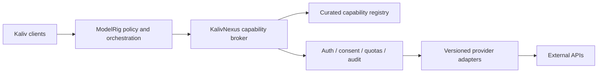

# KalivNexus ecosystem boundaries (proposal)

> **Status: proposal, not verified functionality.** This page states the
> *intended* authority boundaries for KalivNexus inside the Kaliv ecosystem.
> Nothing here asserts a runtime, API compatibility, deployed service or
> production readiness. The imported v0.50.0 code on this branch has **not**
> been validated against these boundaries.

**Provenance.** The sections below are copied verbatim from `README.md` on
`main` at `6e25c635e` (lines 5–47 and the first paragraph of "Release
discipline"). They were moved here because the v0.50.0 reconciliation (#22)
restores the original archive `README.md` on `bootstrap/v0.50.0-baseline`.

**Deliberately not copied:** `main`'s status line, "Suggested documentation
roadmap", "Current prototype" and "Compare offline catalog snapshots". Those
describe `main`'s offline manifest-catalog prototype (`scripts/validate_manifest.py`,
`examples/`, `.github/workflows/validate-manifests.yml`), which does not exist on
this branch. They remain authoritative on `main`.

See also: [Architecture decisions](ARCHITECTURE_DECISIONS.md) and
[Complete v0.50.0 baseline import](COMPLETE_BASELINE_IMPORT.md).

---

## Purpose

Provide a governed way to discover, describe and invoke external capabilities without coupling ModelRig or Kaliv clients to each provider's API. The [API-mega-list](https://github.com/cporter202/API-mega-list) is an inspiration and candidate catalog, **not** an automatically trusted or enabled integration registry.

## Ecosystem boundaries

- [ModelRig](https://github.com/Ternedal/ModelRig): orchestration, cognitive state, authenticated client facade, tool authorization and user confirmations.
- [Kaliv](https://github.com/Ternedal/Kaliv): public website/product presentation; application clients use ModelRig's approved interfaces.
- [VoiceRig](https://github.com/Ternedal/VoiceRig): voice packages and TTS.
- [VisionRig](https://github.com/Ternedal/VisionRig): sensor ingestion and structured visual observations.
- [BodyRig](https://github.com/Ternedal/BodyRig): body identity and motor state.
- [LanguageRig](https://github.com/Ternedal/LanguageRig): language-model training and evaluation.
- [KalivHub](https://github.com/Ternedal/KalivHub) / [Receiver](https://github.com/Ternedal/KalivHub-Receiver): home dashboard and display-only Cast receiver.
- [SkyPlayer-Engine](https://github.com/Ternedal/SkyPlayer-Engine): XR/media primitives.

Nexus should describe and execute approved external integrations; it must not independently acquire durable-memory, perception-truth, identity, or unrestricted action authority.

## Proposed architecture

## Proposed capability manifest

Each integration should declare a stable identifier, provider, version, input/output schema, authentication method, permissions, data classifications, rate limits, timeout/retry policy, idempotency, costs, health probes and approval requirements. Treat remote descriptions and responses as untrusted data.

## Security and operational requirements

1. Default deny; integrations are disabled until explicitly configured and approved.
2. Store secrets outside Git and logs; support rotation and per-provider isolation.
3. Enforce SSRF protection, network egress allowlists, TLS verification and response-size limits.
4. Require explicit ModelRig authorization for side effects; separate read-only from write/destructive operations.
5. Bound timeouts, concurrency, retries and monetary quotas. Use idempotency keys for repeatable writes.
6. Produce redacted audit trails with correlation IDs; never log access tokens or sensitive payloads.
7. Preserve provider attribution, terms of use and data retention restrictions.
8. Do not assume cloud providers are local-first or privacy-equivalent; surface external transfer before invocation.

## Release discipline

Document **proposed**, **implemented**, **automated-test verified**, **physically tested**, and **released** separately. This README describes a proposal, not delivered functionality.
